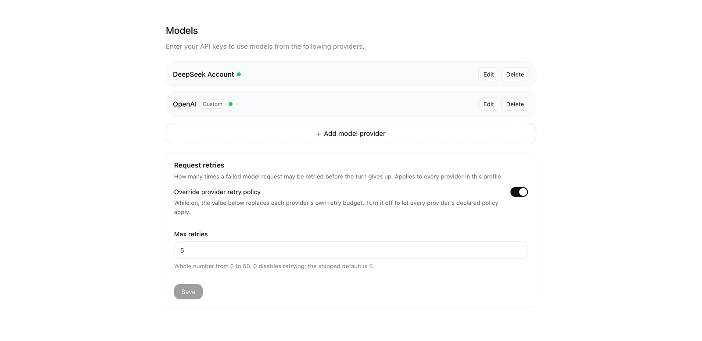

# dsh-model-retry-settings

A [DeepSeek Harness](https://github.com/deepseek-ai/deepseek-harness) (dsh) plugin: a **max retries** control on the web GUI's **Settings → Model** page, the one preference the shipped composition has no surface for.
**English** | [简体中文](README.zh-CN.md)

[](LICENSE)
[](https://github.com/icrefin/dsh-model-retry-settings/releases/tag/v1.0.2)
[](https://github.com/icrefin/dsh-model-retry-settings/commits/main)
[](https://github.com/icrefin/dsh-model-retry-settings/stargazers)
[](https://github.com/icrefin/dsh-model-retry-settings/pulls)
[](https://nodejs.org)
[](https://github.com/deepseek-ai/deepseek-harness)

**Request retries** — one card at the foot of **Settings → Model** that decides
how many times a failed model request is retried, for every provider in the
profile.

## What it does

dsh resolves a request-retry policy **per provider route**: an adapter's
`providerRetryPolicy()` is captured when that route registers
(`@deepseek-ai/dsh-llm/retry-policy`), the agent loop carries the resolved policy
into the `agent/request-error` waterfall on every failed attempt, and the
optional `@deepseek-ai/dsh-llm-retry` plugin executes it as durable `llm/retry`
events. Nothing in the shipped composition lets a person change that number
without hand-editing provider configuration.

This plugin owns the preference instead:

- it rides **its own Loader entry's `Config`** as its settings namespace — since
  dsh 0.1.7 an entry's Config *is* its settings namespace, so both fields are
  `.volatile()` and become writable through the ordinary settings transport;
- the browser half renders the control into the Models page's designed
  extension seat, `settings.models.footer`;
- the host half rewrites the policy the retry executor is about to read.

| Field | Type | Default | Meaning |
|---|---|---|---|
| `enabled` | boolean | `true` | While off, every provider's own retry policy applies untouched. |
| `maxRetries` | integer 0–50 | `5` | Retries one failed model request may make. `0` disables retrying. |

`5` is dsh's own shipped default (`DEFAULT_MAX_RETRIES` in
`@deepseek-ai/dsh-llm/retry-policy`), so a fresh install behaves like a stock one
until you change the value.

## Where it sits in the page

```
Settings ▸ Model
├── DeepSeek account                     [provider row]
├── Example provider                     [provider row]
├── + Add provider
└── Request retries                      ← this plugin
     ├── Override provider retry policy  [switch]
     └── Max retries                     [whole number, 0–50]
```

*(Provider rows are whatever this deployment has configured; the second one is a
placeholder.)*



*The card renders below the provider rows and the add controls. Rendered from
the shipped bundle by [`tools/preview.mjs`](tools/preview.mjs).*

## How the override lands

The host half registers one listener on the `agent/request-error` waterfall with
`{ prepend: true }`. `ctx.waterfall` composes listeners **outermost-first**, so a
prepended listener runs before the retry executor registered by `dsh-base` — and
the substituted policy is what that executor destructures out of the very same
payload object:

```js
ctx.on('agent/request-error', (payload, next) => {
  const { enabled, maxRetries } = resolveEffectiveConfig(config)
  const policy = payload?.retryPolicy
  if (enabled && policy?.mode === 'normal' && policy.maxRetries !== maxRetries) {
    payload.retryPolicy = Object.freeze({ ...policy, maxRetries })
  }
  return next()
}, { prepend: true })
```

Everything mechanical stays with `dsh-llm-retry`: the durable retry counter and
its `sessionProjections` state, the backoff schedule, and the `llm/retry` /
`llm/retry-started` session events the trajectory renders. This plugin changes
only the number.

Consequences worth knowing:

- **Only `mode: 'normal'` policies carry a `maxRetries`.** An `always` policy is
  left exactly as its provider declared it, and so is an absent policy.
- **The value replaces, not caps.** Setting it above a provider's declared budget
  raises it; the provider's `retryPolicyKey` changes with it, so the durable retry
  counter tracks the new policy cleanly.
- **Without `dsh-llm-retry` composed, the preference has no effect** — with no
  executor, no request is retried at all. `dsh-llm-retry` is in `dsh-base`, so
  every shipped profile has it.
- Volatile values are updated **in place** on the running fiber, so the listener
  reads the current value on every failure: no subscription, no re-`apply()`, no
  restart. The Settings page's own save is the only write.

## Requirements

| Requirement | Why |
|---|---|
| DeepSeek Harness `>=0.2.1-rc.5 <0.2.2-0` | the range this plugin is built and verified against (0.2.1-rc.5); the card needs the Models settings page's `settings.models.footer` seat |
| Node `^22.19.0 \|\| >=24.0.0` | the range declared in `package.json` (`engines`) |
| `@deepseek-ai/dsh-llm-retry` composed | the retry executor itself; it ships inside `dsh-base`, so every stock profile has it |
| Google Chrome, for `node tools/preview.mjs` only | the preview harness renders the card outside the GUI and screenshots it with headless Chrome; neither the plugin nor the suites need a browser |
| Node, for `sh scripts/verify.sh` | plus the DeepSeek Harness desktop app and network access on its first run, see below |

`sh scripts/verify.sh` takes the real `@deepseek-ai/*` packages out of the
installed desktop app's `app.asar`, so it needs that app present (set `DSH_ASAR`
for a non-default location) and network access on its first run. The client
packages the web shell inlines as platform seeds (`dsh-client-ui-primitives`,
`dsh-client-ui-slots`, `dsh-client-store`) are no longer installed under the
app's `node_modules`, so the harness fetches those three from npm pinned to the
installation's own version. For that reason the suites are not wired into hosted
CI: this repository ships no workflow, and `sh scripts/verify.sh` is the gate you
run on a machine that has DeepSeek Harness installed.

## Install

This repository is a standalone plugin package: `lib/index.js` (host) and
`lib/client.js` (browser) are committed in the forms dsh loads them in.

```sh
git clone https://github.com/icrefin/dsh-model-retry-settings.git
cd dsh-model-retry-settings

sh scripts/install.sh                 # pack to dist/, then print what to do
sh scripts/install.sh --profile tui   # pack and install into a CLI-managed profile
sh scripts/verify.sh                  # check the checkout against the real dsh SDK
```

For the **desktop** profile the app owns the profile, so `dsh plugin add` refuses
it: install the packed tarball from **Settings → Plugins**, or hand
`dist/dsh-model-retry-settings-<version>.tgz` to the plugin-manager tool.

Two things are load-bearing:

- **Install the tarball, not the directory.** A `link:` dependency points outside
  the profile's `node_modules`, so the harness host can only reach it once it has
  registered that path as a linked root — which happens at boot. A packed tarball
  installs as a real directory under `<profile>/node_modules/`, the same shape a
  registry plugin has, so the installation's module-interception layer resolves
  its `@deepseek-ai/*` peers the moment the profile loads it.
- **Restart the harness after adding it.** A bundle added to an *already running*
  profile cannot be imported by that process: the new module path is not in the
  resolution the host computed at boot, so the entry reports `failed to import`
  and stays inactive. This is true of any newly added bundle, not this plugin
  specifically — a deliberately minimal `export function apply() {}` substituted
  into the installed copy fails the same way, and the same bundle activates
  cleanly on the next start. The plugin manager reports this case as
  `restart-required`.

After the restart, open **Settings → Model**; the card sits below the provider
rows and the add controls. Saving writes the preference through the shared
settings transport.

To iterate on the plugin: edit `lib/`, run `sh scripts/install.sh`, and restart —
or install into a throwaway profile with `sh scripts/dev-profile.sh`, where
`link:`-style iteration is cheap.

## Configuration

The card is the only surface. There is no Loader config file to edit and no
plugin-specific state outside the settings document.

| What | Where |
|---|---|
| the preference | the fields `enabled` and `maxRetries` of the `model-retry-settings` settings namespace |
| what that namespace is | this plugin's own Loader entry `Config` (`id: model-retry-settings` in `cordis.patch.yml`) — since dsh 0.1.7 an entry's Config *is* its settings namespace |
| how the card reads and writes it | `ctx.configForms.get('model-retry-settings')`, the same shared fenced form the host publishes, so a save is an ordinary settings mutation and the host stays the only authority on whether a value was accepted |
| what happens to the running process | nothing to restart: both fields are `.volatile()`, so a save updates the value in place on the running fiber and the next failed request reads the new number |

The entry id, the settings namespace, the client's `ctx.configForms.get(...)` and
the `settings.models.footer` registration id are all `model-retry-settings` and
must agree; `cordis.patch.yml` carries the same value.

There is **no build step**. `lib/index.js` (host) and `lib/client.js` (browser)
are hand-authored in the forms dsh loads them in — plain ESM for the host, and
the module loader's `window.__ModuleLoader__.load({ id, factory })` factory form
for the browser, which is also why the plugin needs no bundler.

Development scripts, all run from the clone:

```sh
sh scripts/verify.sh           # 37 checks against the real dsh SDK (host + browser halves)
sh scripts/install.sh          # pack to dist/ and print the install path
sh scripts/dev-profile.sh boot # boot this plugin in an isolated profile on :19499
sh scripts/dev-profile.sh dump # print the composed profile tree
sh scripts/dev-profile.sh url  # print the served client-bundle URL
sh scripts/dev-profile.sh remove
```

`sh scripts/dev-profile.sh` writes only under `.dev-home/` inside the clone: a
private dsh home with its own profile, so the profile the desktop app is using is
never touched. That is also where a change is cheapest to check — a fresh boot
composes the profile with the plugin already in it, so it activates.
[`test/README.md`](test/README.md) documents exactly what each suite proves.

## Limits

- One global preference. Per-provider retry budgets remain a provider-config
  concern (`providers.<name>.retryPolicy` in `dsh-llm-pi-ai`).
- The `always` retry mode is not addressable — it has no `maxRetries` by design.
- `maxRetries` is capped at 50. The schema and the browser field share the bound
  so a rejected draft never reaches the Host, but a deployment that wants a
  higher ceiling must change `MAX_RETRIES_LIMIT` in both halves.
- No retry-budget surface for a single session; the value is process-wide.

## Troubleshooting

**The card is missing from Settings → Model.**
The client half registers the card only while the host serves the
`model-retry-settings` namespace (`ctx.configForms.whileServed`), so a profile
that never composed the host half shows no card at all — a card that could not
save must not appear. Check that the bundle is in the profile and that the
harness has been restarted since it was added.

**The entry reports `failed to import` after I installed it.**
Expected for a bundle added to an already running profile: the host computed its
module resolution at boot, so the new path is not in it. Restart the harness; the
bundle activates cleanly on the next start. The plugin manager reports this case
as `restart-required`.

**I changed the number and nothing was retried.**
Check the switch first: while *Override provider retry policy* is off, every
provider's own policy applies untouched, and `0` disables retrying on purpose.
Then check the provider's mode: only `mode: 'normal'` policies carry a
`maxRetries`, so an `always` policy is left exactly as declared. Finally, nothing
is retried at all in a profile without `dsh-llm-retry` composed.

**I lowered the number below a provider's budget and it still retried that many times.**
The value **replaces** the policy rather than capping it, so a stale card, a
second running harness, or a provider whose policy is re-resolved can look like
the setting was ignored. Re-open the card to see the value the host actually
serves, and make sure only one harness is serving the profile.

**The Save button refuses my draft.**
The field accepts only a whole number from 0 to 50; anything else is marked
invalid in place and blocks the save, so a rejected draft never reaches the host.
An empty field clears the value, which falls back to the composition default.

## License

MIT — see [LICENSE](./LICENSE).

> If this card saves you a hand-edit of provider configuration, a ⭐ star helps
> other dsh users find it.

<sub>Built against DeepSeek Harness 0.2.1-rc.5 · MIT</sub>
